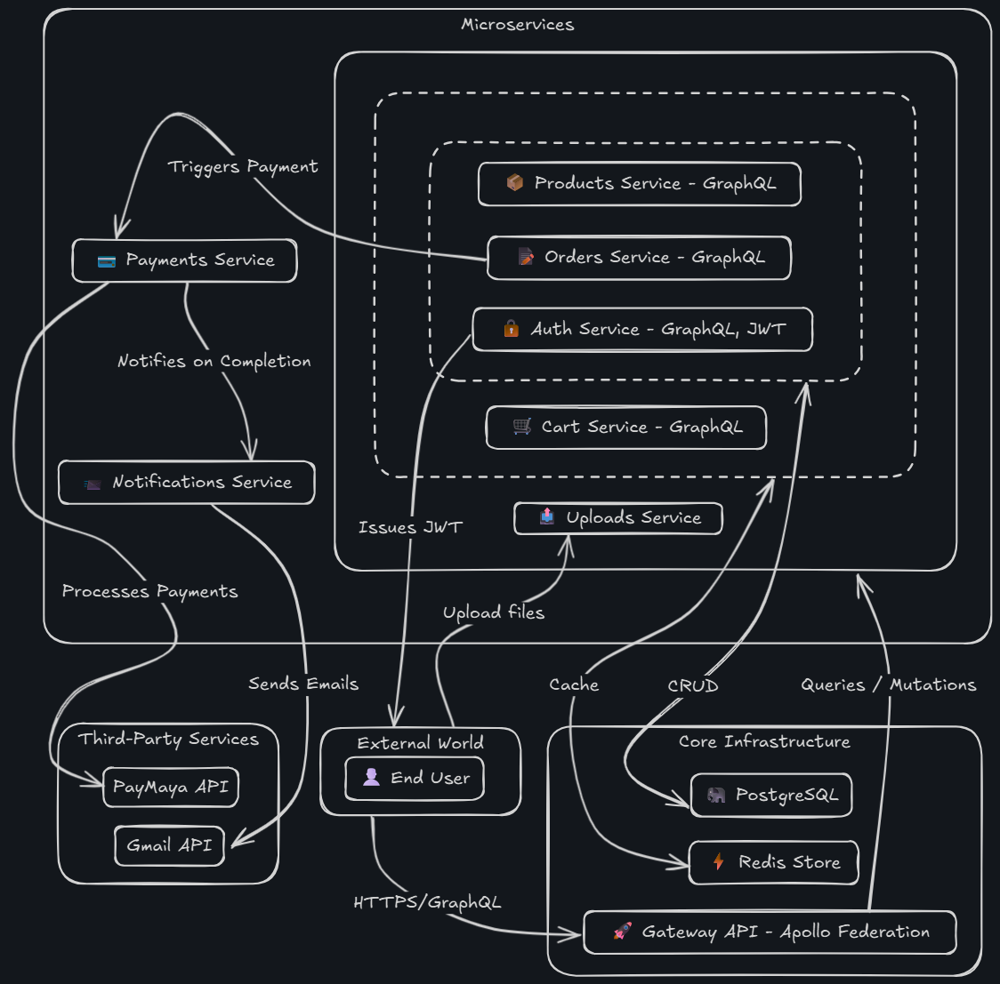

# Mercado

The backend of an e-commerce store, split into eight NestJS services behind one GraphQL gateway. I built it to learn how a microservices system fits together in practice. Services own their own data, talk to each other over TCP, and show up to the client as a single federated graph. The frontend that uses it is [mercado-front](https://github.com/janrizmlibres/mercado-front).



## Services

| Service | Port | What it does |
|---|---|---|
| `gateway` | 3003 | Apollo Gateway. Composes the subgraphs into one schema and checks the `Authentication` header with `auth` before forwarding the user to each subgraph. |
| `auth` | 3001 | Users, registration and login. `POST /auth/login` returns a JWT. Answers `authenticate` over TCP for the other services. PostgreSQL through Prisma, with users cached in Redis. |
| `products` | 3002 | Products and their variants. PostgreSQL through Prisma. |
| `cart` | 3005 | Carts, stored in Redis. Clears items when a user or product is deleted. |
| `orders` | 3000 | Orders and order items. PostgreSQL through Prisma, cached in Redis. Asks `payments` for a checkout when an order is placed. |
| `payments` | 3004 | Creates a checkout in the PayMaya (Maya) sandbox and returns its redirect URL. Tells `notifications` to email the buyer. |
| `notifications` | TCP only | Sends email with Nodemailer through Gmail OAuth2. |
| `uploads` | 3006 | `POST /uploads/image` takes one image up to 5 MB and serves it back from `/images`. Plain REST, not part of the graph. |

`gateway` federates every service except `notifications` and `uploads`. Code the services share, such as the JWT guard and the DTOs, lives in `libs/common`.

## Running it

You need Node.js, pnpm and Docker.

```bash
git clone https://github.com/janrizmlibres/mercado-ecommerce.git
cd mercado-ecommerce
pnpm install
docker compose up
```

Compose starts every service plus PostgreSQL 17 and Redis. The services with a database run their Prisma migrations on start. `docker compose watch` syncs source changes into the containers.

Each service reads its own `apps/<service>/.env`, and there are no example files yet. Every service validates its variables on start and names any that are missing. The main ones are below.

| Service | Variables |
|---|---|
| `auth` | `DATABASE_URL`, `REDIS_URL`, `JWT_SECRET`, `JWT_EXPIRATION`, `HTTP_PORT`, `TCP_PORT` |
| `orders` | `DATABASE_URL`, `REDIS_URL`, `PORT`, `AUTH_HOST`, `AUTH_PORT`, `PAYMENTS_HOST`, `PAYMENTS_PORT` |
| `gateway` | `PORT`, `AUTH_HOST`, `AUTH_PORT`, and a `*_GRAPHQL_URL` per subgraph |
| `notifications` | `PORT`, `SMTP_USER`, `GOOGLE_OAUTH_CLIENT_ID`, `GOOGLE_OAUTH_CLIENT_SECRET`, `GOOGLE_OAUTH_REFRESH_TOKEN` |

To push images to Docker Hub, set `DOCKER_USER` and run `scripts/build-and-push-all.sh`.

## Status

A learning project, deployed once on Railway. Payments run against the Maya sandbox only, and the buyer's email goes out when the checkout is created, not after it is paid.

## License

MIT. Released 2025 by Janriz Libres. See [LICENSE](LICENSE).
